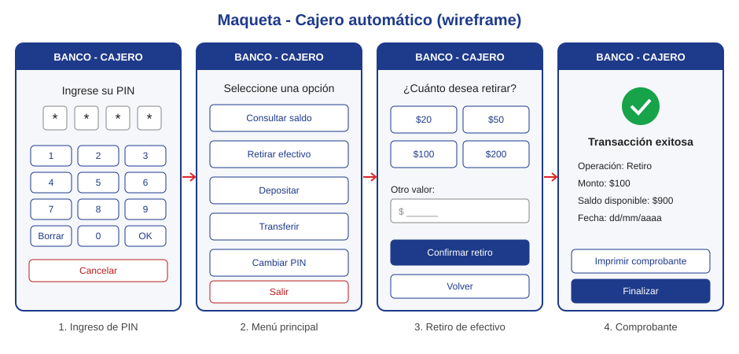

# Proyecto Cajero Automático

Sistema de cajero automático (ATM) que permite a un cliente autenticarse con su tarjeta y PIN para consultar su saldo, retirar efectivo, depositar y transferir dinero.

## Maqueta

## Contenido del repositorio

| Entregable | Archivo |
|---|---|
| Maqueta del proyecto | [docs/maqueta/maqueta-cajero.svg](docs/maqueta/maqueta-cajero.svg) |
| Diagramas UML (casos de uso, clases y secuencia) | [docs/uml/diagramas-uml.md](docs/uml/diagramas-uml.md) |
| Roles del equipo | [docs/roles-del-equipo.md](docs/roles-del-equipo.md) |
| Historias de usuario | [docs/historias-de-usuario.md](docs/historias-de-usuario.md) |

## Equipo

- **[TU NOMBRE]**: proyecto individual, asume todos los roles (ver [roles del equipo](docs/roles-del-equipo.md)).
