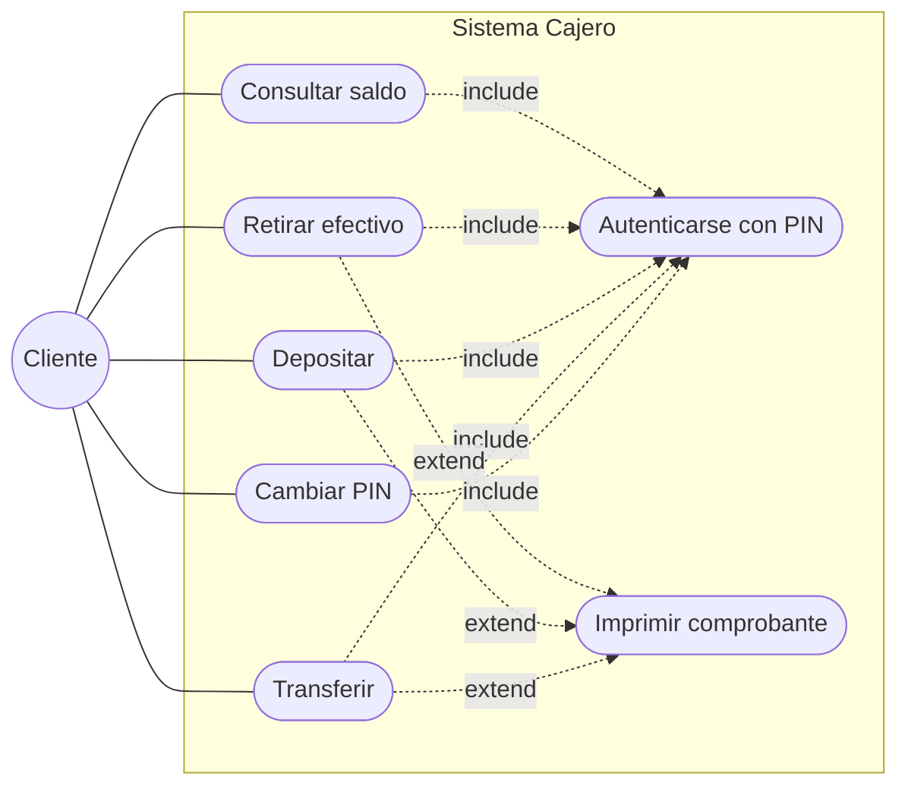
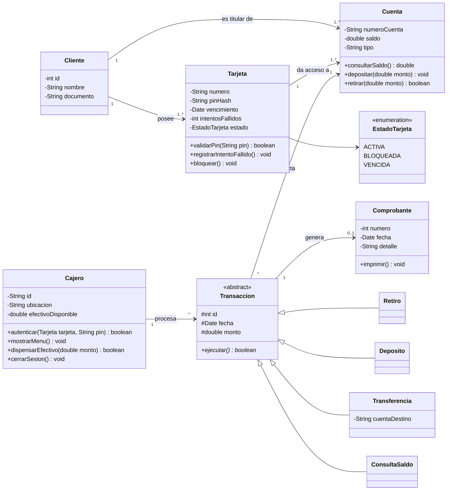
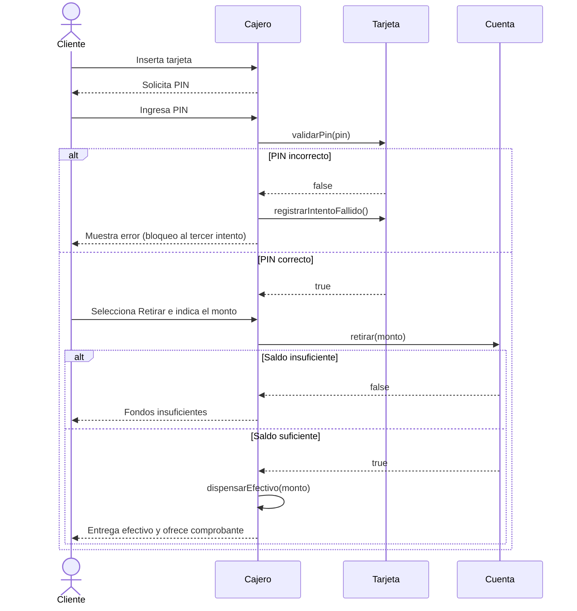

# Diagramas UML del Cajero Automático

Los diagramas están escritos en [Mermaid](https://mermaid.js.org/), por lo que GitHub los muestra como imagen directamente en esta página.

## 1. Diagrama de casos de uso

## 2. Diagrama de clases

### Decisiones de diseño

- **Herencia y polimorfismo:** `Retiro`, `Deposito`, `Transferencia` y `ConsultaSaldo` heredan de `Transaccion` y cada una implementa su propio `ejecutar()`.
- **Seguridad:** el PIN no se guarda en texto plano (`pinHash`) y la tarjeta se bloquea tras 3 intentos fallidos.
- **Responsabilidades separadas:** `Cuenta` controla el saldo, `Cajero` controla el efectivo físico y la interacción con el cliente.

## 3. Diagrama de secuencia: retirar efectivo

